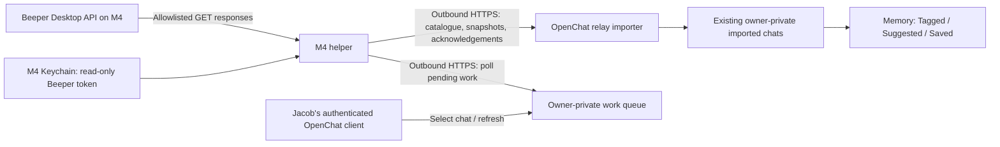

# Beeper → OpenChat: M4-local, outbound-only adapter

Status: proposed implementation design, 2026-11-17. Origin: Jacob/root d3caa262;
owner: f056aa6a. Memory is already deployed by PR243. This document does not
claim a working adapter or a completed real-chat UI acceptance run.

Jacob creates a **READ-ONLY Beeper Desktop API token**. It stays on M4.
**No further Beeper database reads or copies are permitted.** There is no database,
Matrix-token, browser-profile or credential-discovery fallback. Historical source
proof is not continuing authorization to use a database.

## Architecture and boundary

Choose an M4-local helper that pulls from Beeper's loopback API and pushes into
OpenChat. Reuse the existing imported-chat service for conversation data and the
existing private graph for Memory. Introduce only owner-private connection,
catalogue and delivery-job metadata, not another message or memory store.

No new M4 listener, public tunnel, reverse SSH, cloud-to-M4 connection or browser
fetch to the Mac API. No shared daemon restart or automatic startup installation.
Begin with an explicitly run foreground helper. Beeper's existing local listener
continues unchanged. API reads and network validation occur on M4; raw payloads
travel directly from M4 to Jacob's private OpenChat service over HTTPS, never
through Linux task files, reports or a third-party processor.

## Two separate credentials

1. **Beeper read-only token:** Jacob supplies it through a local protected entry
   flow. Store in M4 Keychain; load into helper memory. Do not put it in command
   arguments, logs, URLs, a broad environment file, git, Linux or OpenChat.
   Confirm the approved read-only connection after creation; its capabilities
   have not yet been verified. A helper GET-only policy applies regardless.
2. **OpenChat relay grant:** pair the helper to Jacob's authenticated OpenChat
   account using a short-lived, single-use pairing approval. A pairing request
   alone grants nothing. Owner login and explicit approval bind the device and
   permitted WhatsApp account; grant delivery occurs over the paired M4 HTTPS
   session. Keep its secret in M4 Keychain and only a verifier/hash server-side.

Do not reuse the Beeper token for OpenChat authentication. Prefer a new narrow
relay principal over a general `oc_` read/write agent key. The current import
route accepts owner sessions/owner-issued keys; its broad key scopes are not a
relay capability model. Do not widen shared-connector access to get around that.

The relay principal can publish metadata, claim its own work, and deliver data
only for its owner, paired account and selected chat. It cannot read arbitrary
private notes, save memory, send native OpenChat messages, delete chats, mint
keys, publish anything or act as another owner. Owner identity is derived from
the approved grant, never a payload `ownerId`. Existing owner UI authentication
continues to read conversations and write Memory. Revoke/pause from OpenChat;
revocation invalidates polling, upload and leased work before any next write.
The helper may already have a local GET or upload in flight and cannot learn
revocation instantly. The server rejects revoked uploads at the transactional
write fence; the helper stops further work when it receives that rejection. Never discover or reveal existing credentials as part of pairing.

## Beeper API allowlist

The fixed local origin is `http://127.0.0.1:23373`, evaluated on M4. A verified
local port override can be configured locally, never by a cloud job. The helper
rejects redirects, arbitrary URLs/headers, path traversal and all other methods
or paths. Use a small typed HTTP client with no generic command execution.

| Purpose | Allowed API operation |
|---|---|
| Capability preflight | `GET /v1/info` |
| Identify permitted WhatsApp account | `GET /v1/accounts` |
| Catalogue | `GET /v1/chats` (and `/v1/chats/search` if installed support is verified) |
| Selected chat metadata | `GET /v1/chats/{encodedChatId}` |
| Selected chat history | `GET /v1/chats/{encodedChatId}/messages` |

The current documentation describes [account listing](https://developers.beeper.com/desktop-api-reference/resources/accounts/methods/list/),
[chat listing](https://developers.beeper.com/desktop-api-reference/resources/chats/methods/list/)
and [message listing](https://developers.beeper.com/desktop-api-reference/resources/messages/methods/list/).
Treat pagination cursors as opaque. Check the installed API response shape using
the approved connection; documentation for a newer version is not proof of local
capabilities. [Authentication](https://developers.beeper.com/desktop-api/auth/)
is an actual gate, not a prompt to recover credentials from other files.

There are no focus/open-chat, mark-read/unread, typing, reaction, message-send,
archive, edit, delete, bridge-login or asset-download calls. Reading a conversation
in OpenChat never invokes a Beeper UI/deep link that might change read state.
First slice imports attachment metadata only. Do not follow attachment paths,
preview URLs, redirects or external links. Existing link-title text, if available,
can be considered in a later explicit import-schema extension without fetching
third parties; v1 does not currently preserve that structured metadata.

## Generic picker without bulk message import

After pairing, Jacob enables **Show my WhatsApp chat list**. Publish only the
permitted account's minimal catalogue: opaque account/chat keys, actual title,
direct/group kind, known last-activity time and catalogue read time. Drop message
previews, snippets, member rosters, unread/read flags, avatars and attachment URLs
from catalogue responses before upload. Do not import message bodies until Jacob
selects a chat. Do not hardcode a trip or a particular title.

OpenChat adds **WhatsApp chats** from Chats, visible when the connection exists
even if no conversation has been imported. Search/filter the owner-private
catalogue. Selecting a row creates a scoped load job and opens a loading reader;
its title is the selected chat's actual title. After first data arrives, reuse
the imported Conversation/People/Asks/Memory surfaces. Refresh requests source
work; it does not merely reload the already imported copy.

A device can populate catalogue entries for its paired account, but message
uploads require a server-issued job/selection grant bound to one catalogue key.
M4 also validates that key against its local mapping and permitted account. A
cloud job is typed data, never a URL, shell command or request template.

## Proposed OpenChat protocol (not existing endpoints)

| Caller | Operation | Restriction |
|---|---|---|
| Owner app | Pair/revoke/pause connection | Existing direct owner session; single-use pairing approval |
| M4 | Publish catalogue and heartbeat | Relay grant; owner/device/account-fenced metadata only |
| Owner app | Request load/refresh/history page | Authenticated owner + catalogue chat; coalesce duplicate work |
| M4 | Poll/claim work | Outbound HTTPS, fixed origin; short bounded lease |
| M4 | Submit batch + acknowledge | Same grant/lease/job/account/chat; bounded sequence and digest |
| Owner app | Read job/freshness state | Owner-fenced, `no-store` |

The existing `importChat()` opens its own transaction, so a precheck wrapper is
insufficient. First refactor its existing transactional body into an internal
`importChatInTransaction(tx, owner, parsedPayload, options)` entry point, shared by
normal imports and the relay. Keep parsing before writes and preserve existing
owner import behavior/tests. The normal API still owns its transaction; the relay
owns one transaction containing the checks, import and receipt. Do not forward a
forged owner session or open the existing import route to a broad new actor.
All other app routes reject relay credentials. Proposed transport records may use `OpenChatImportConnection`,
`OpenChatImportCatalogue` and `OpenChatImportJob` labels, each owner/device-fenced;
conversation bodies remain under existing `OpenChatImported*` labels.

A batch envelope contains `jobId`, `leaseId`, `scanId`, monotonically increasing
`sequence`, digest and the existing v1 import payload. Server binds source keys
from the approved job, not arbitrary envelope values. A duplicate sequence with
the same digest returns its original acknowledgement; changed content at the same
sequence is rejected.

Use a consistent lock order across import, job creation/supersession, revocation
and account deletion: owner User, connection/grant, job, then imported chat (when
present). The transaction-aware import body reuses those locks instead of opening
a nested session. Check expiry, current grant, selected-chat scope and current
server-issued scan epoch under the locks, apply the import, and write its receipt
in that same transaction. Revocation/job supersession uses the same owner/grant
locks so its commit is the authority boundary. A revoked or obsolete upload
cannot commit later based on an earlier middleware check. Account deletion keeps
the existing owner lock/fence. Any import or receipt error rolls back the whole
batch. Test both race orders and a failure between import and receipt creation.

Existing imports may return HTTP success with nonempty immutable sender/time
`conflicts`, leaving those messages unchanged. The relay must inspect the result
inside its transaction and reject/roll back such a batch with an explicit
reconciliation failure; no successful receipt or last-success update is written.
It must not silently label a conflicting batch refreshed.

Do not trust an obsolete lease just because upload started earlier. Server assigns
a monotonic per-chat scan epoch at job creation. It is distinct from source
capture time. The relay importer enforces the server epoch under the
chat lock; Mac wall-clock values cannot choose ordering. Keep source-read time,
server receipt time and scan completion time separately, validate clock skew and
show uncertainty. Preserve the normal v1 import API's existing as-of guard; the
new internal relay mode must explicitly account for epoch ordering without
inventing a source-read timestamp. Relay-owned sources cannot be overwritten by
an ordinary v1 upload without explicit owner detachment/reconciliation.

Initial limits: one active source job per chat, a small device concurrency cap,
and batches of at most 100 messages and 1 MiB encoded JSON, below existing v1
limits of 5,000 messages / 16 MB. Source messages exceeding existing field limits
fail visibly rather than silently truncating source text. Successful earlier
batches remain labelled partial if a later batch fails. A job is successful only
when every required batch is durably acknowledged. Reclaim/resume starts at the
last acknowledgement, and snapshot ordering rejects superseded work.

Owner account deletion must revoke the connection and purge every new catalogue,
job, lease and receipt record as well as existing imported content, under the
same owner fence. Existing imported-chat cleanup does not automatically cover new
transport labels. Add this explicitly. Owner export includes relevant private
catalogue/sync metadata but excludes credential verifiers, pairing secrets and
M4 identity keys. Define expiry/retention for completed jobs and abandoned pairing
records; no source body belongs in queue or telemetry records.

## Stable identity and source mapping

Keep raw Beeper identifiers on M4. Derive opaque account/chat/participant/message
keys with a stable M4-held HMAC identity key and distinct domain prefixes; include
account and chat scope as appropriate. Do not derive identity from names, titles,
phone display text or timestamps. Persist the identity key securely on M4, separate
from API credentials; revoking/replacing a token must not change conversation IDs.
Loss of identity state requires explicit reconciliation, not automatic duplicate
imports or a guessed merge. Verify canonical ID stability across API refreshes.

| API information | Existing import representation |
|---|---|
| Selected WhatsApp account/chat IDs | Scoped opaque `accountKey` / `chatKey`; network `whatsapp` |
| Chat type/title | `direct` or `group`; actual source title |
| Message ID, timestamp, sender | Stable `sourceMessageId`, immutable `sentAt`, scoped `senderKey` |
| Source text or media caption | `text`; preserve source words and explicit hashtags |
| Attachment metadata | Media kind/type placeholder; no bytes/paths/remote fetch |
| Reported source edit/deletion | `editedAt` or deleted tombstone; never infer deletion from absence |
| Reply target | Scoped source message reference, when available |
| Source-provided person name | Participant display name + honest name provenance; else unknown |

Only mark the owner from verified source account/self identity. Do not infer
sender identity from equal names or turn participants into OpenChat accounts.
Exclude hidden/reaction/control events from normal message text; label unsupported
content honestly. Deletion tombstones lacking required original attribution/time
need stored identity metadata or an explicit reconciliation extension; do not
invent a sender/time or restore deleted text. Unknown capabilities stay unknown.

Reuse existing import edit/deletion handling, citations, owner-private Memory
saves/dismissals and v1 marker/binding compatibility. Do not generate shared asks
from suggested to-dos, and do not synchronize owner read state to WhatsApp.

## Refresh, coverage and recovery

A foreground helper polls OpenChat over outbound HTTPS (bounded long-poll is
fine) and emits a heartbeat. No inbound connection is needed for commands to be
picked up. Source reads are rate-limited and limited to selected chats. Keep only
identity mapping, cursors, batch receipts and minimal attribution metadata in
private M4 helper state; do not persist source bodies as a spool or copy a Mac DB.
Retry an interrupted batch by re-reading through the API, with a fresh scan if
source content changed. Never send private payloads to diagnostics.

Use the API's newer/older cursor directions for new messages and explicit Load
earlier. Periodically re-read a bounded overlap for edits/deletions. Cursor expiry
causes a bounded rescan, not a claim that missing messages were deleted. Older
edits outside the overlap may be undiscovered: show a reconciliation window and
last successful scan, not a promise of complete realtime sync. An explicit full
available-history scan can be requested separately. API history exhaustion means
only the available Beeper history was exhausted; keep network-history completeness
false/unknown unless independently proved. Omit unknown source row totals.

Reader states distinguish waiting for M4, syncing, partial history, last success,
latest source timestamp, stale/disconnected and authorization required. Heartbeat
expiry cannot be displayed as refresh success. Use server job completion time for
last successful refresh; source coverage/as-of alone is insufficient after a
partially failed batch sequence. Coalesce repeated refreshes; back off network
failures, stop on 401/403 or incompatible responses, and never fall back to SQL.
M4 sleep/Beeper quit is an ordinary unavailable state, not data loss.

Imported readers have no composer and must not show a global banner promising
that queued text will send on reconnect. Their refresh does not modify native
OpenChat conversation read/unread state or the source network's receipts.

## Implementation sequence and acceptance

1. **API contract preflight:** after Jacob's read-only token exists, use only the
   allowlist on M4; verify account identity, installed response/pagination shapes,
   read-only capability and available history. No runtime installation yet.
2. **Server transport and pairing:** narrow grant, metadata-only catalogue,
   owner-select jobs, idempotent relay import wrapper, revocation/lease fencing.
   Reuse import service; refuse relay credentials on unrelated APIs.
3. **M4 foreground helper:** fixed loopback client, Keychain credentials,
   outbound-only jobs/uploads, stable identity and restart receipts. No new
   dependency or startup service is necessary for the first running slice.
4. **Client picker and reader:** generic direct/group selection, progress,
   freshness, true source refresh and existing Memory integration.
5. **Private acceptance:** synthetic non-trip and zero-tag fixtures on phone and
   desktop; then authorized Palisades through the API and owner-private importer.
   Verify select → read → Memory → save/source → refresh/reload, stable IDs,
   replay idempotence, edit/deletion honesty and existing saves. Report aggregate
   categories; private screenshots stay in the authorized owner space.

Required implementation tests include forbidden-method/path/redirect rejection,
no preview/body export in catalogue, grant/owner/account/chat isolation, lease
revocation during upload, duplicate-sequence digest conflicts, restart/clock skew,
partial/oversized batches, cursor expiry, unavailable M4, explicit source deletes,
and proof that open/refresh never calls send/read/focus endpoints. Do not claim
these tests or the adapter exist merely because this design is reviewed.

Current estimate remains provisional: 8–16 implementation agent-hours after the
approved connection, excluding authentication waits and richer media/client work.
The design can be reviewed now; no token values or Mac database access are needed.
